<div align="center">

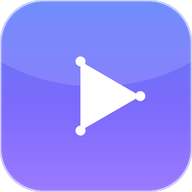

# 小宝影院 · XiaobaoYingYuan

**An ad-free Android video streaming app with a cinematic Aurora UI.**<br/>
Built with Kotlin, Jetpack Compose and Media3 ExoPlayer, with layouts for both phones and tablets.

[](https://github.com/nestchao/XiaobaoYingYuan_APK/releases/latest)
[](https://github.com/nestchao/XiaobaoYingYuan_APK/releases)
[](#-install)
[](https://kotlinlang.org)
[](https://developer.android.com/jetpack/compose)
[](https://nestchao.github.io/XiaobaoYingYuan_APK/)

[**⬇️ Download APK**](https://github.com/nestchao/XiaobaoYingYuan_APK/releases/latest) · [**🌐 Website**](https://nestchao.github.io/XiaobaoYingYuan_APK/) · [**📝 Changelog**](#-changelog) · [**🛠 Build from source**](#-build-from-source)

<br/>

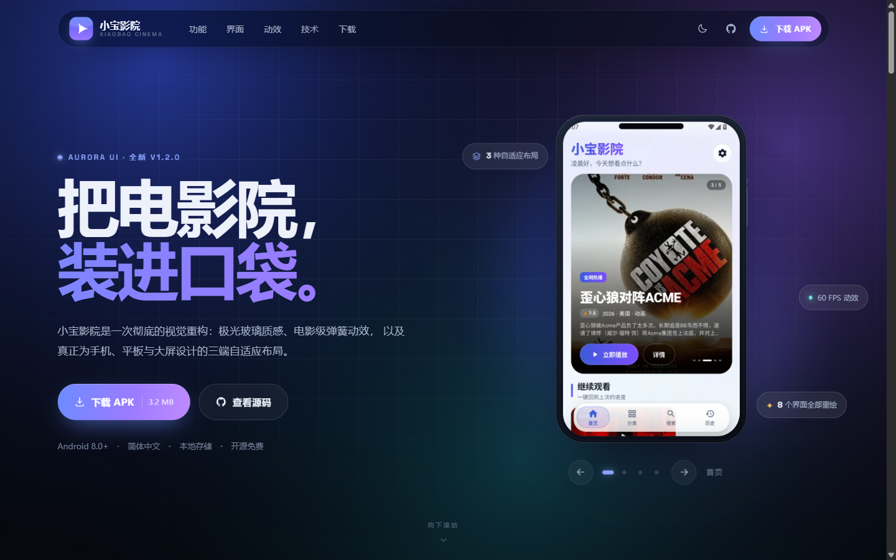

</div>

---

## Contents

- [Highlights](#-highlights)
- [Screenshots](#-screenshots)
- [What's new in v1.3 — Aurora Player](#-whats-new-in-v13--aurora-player)
- [Install](#-install)
- [Features](#-features)
- [Tech stack](#-tech-stack)
- [Architecture](#-architecture)
- [Build from source](#-build-from-source)
- [Project structure](#-project-structure)
- [Changelog](#-changelog)
- [简体中文](#-简体中文)
- [Disclaimer](#-disclaimer)

---

## ✨ Highlights

| | |
|---|---|
| 🎨 **Aurora design system** | Midnight and porcelain themes, frosted-glass surfaces, one brand gradient and spring-physics motion throughout. |
| 🎬 **Immersive player** | Screen lock, picture-in-picture, long-press 2× speed, a time bubble while scrubbing, and gestures for brightness and volume. |
| 📱 **Phone and tablet layouts** | Floating glass bottom bar on phones, an icon rail on portrait tablets, a full sidebar on landscape tablets. |
| ⚡ **Fast playback** | Stream URLs are resolved while you read the detail page, so playback starts as soon as you tap Play. |
| 🔒 **Local first** | No account and no ads. History and preferences stay on your device (Room + DataStore). |
| 🪶 **Small download** | About 3.2 MB release APK, shrunk with R8. |

---

## 📸 Screenshots

<div align="center">

<table>
  <tr>
    <td align="center">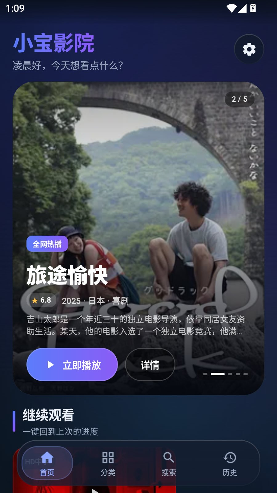<br/><sub>Home · dark</sub></td>
    <td align="center">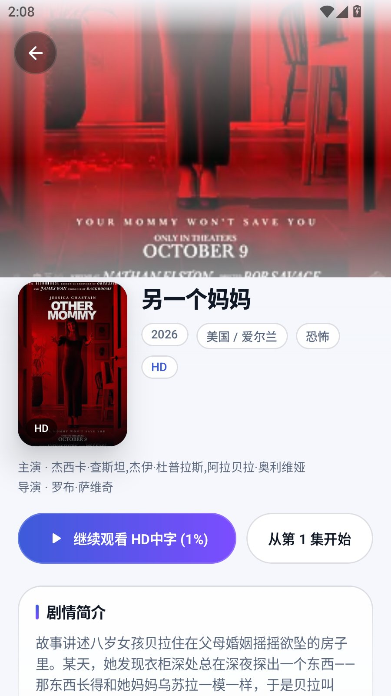<br/><sub>Detail</sub></td>
    <td align="center">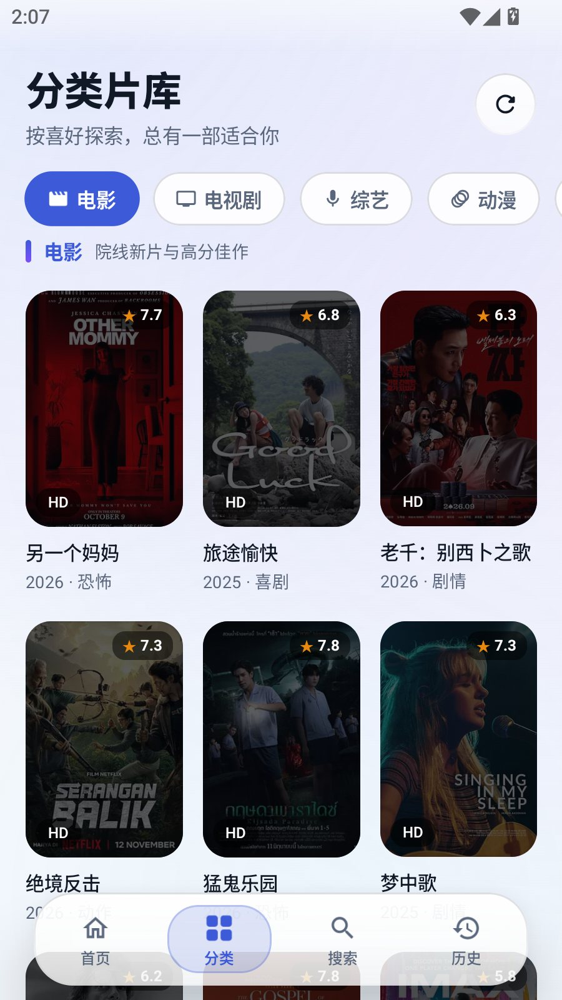<br/><sub>Category</sub></td>
    <td align="center">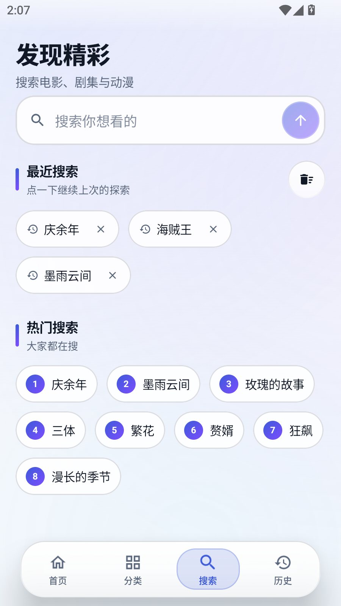<br/><sub>Search</sub></td>
  </tr>
  <tr>
    <td align="center">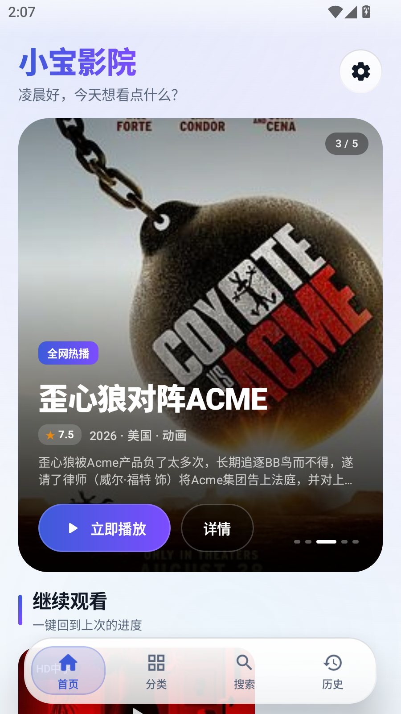<br/><sub>Home · light</sub></td>
    <td align="center">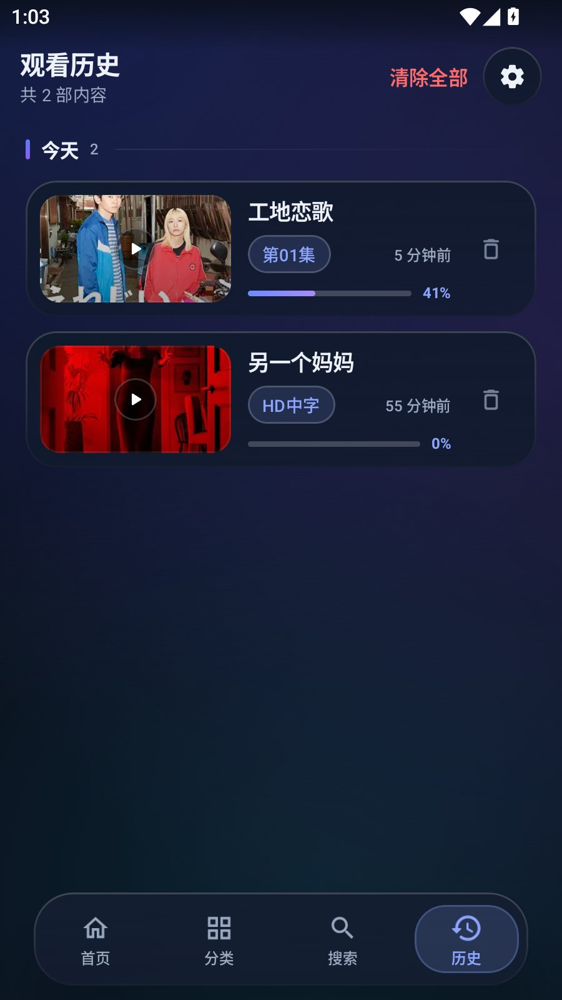<br/><sub>History</sub></td>
    <td align="center">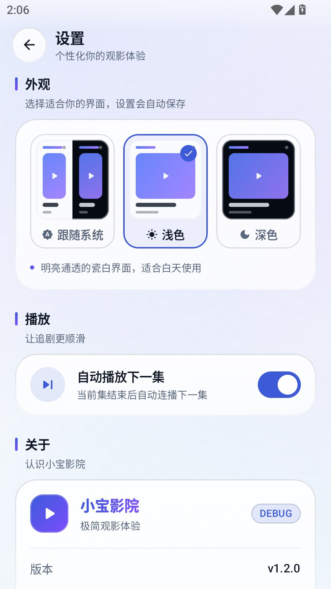<br/><sub>Settings</sub></td>
    <td align="center">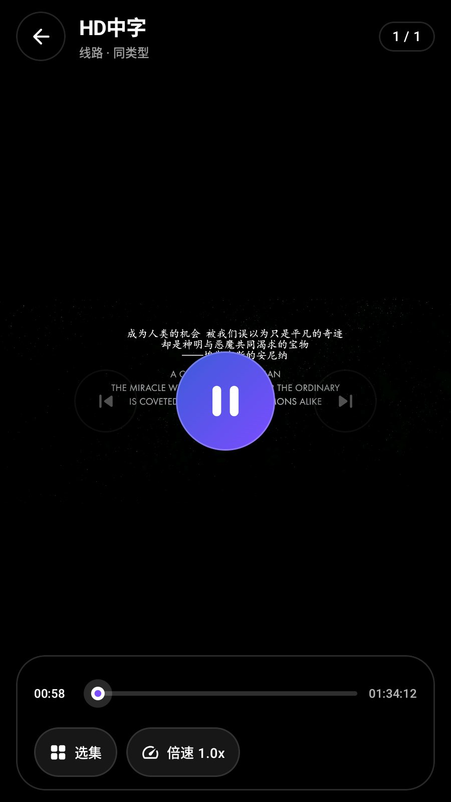<br/><sub>Episode sheet</sub></td>
  </tr>
</table>

**Tablet**

<table>
  <tr>
    <td align="center">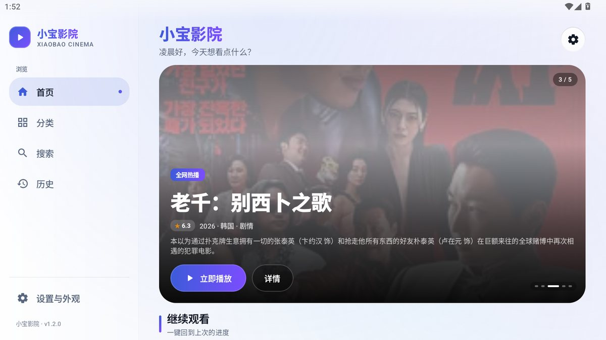<br/><sub>Home with sidebar</sub></td>
    <td align="center">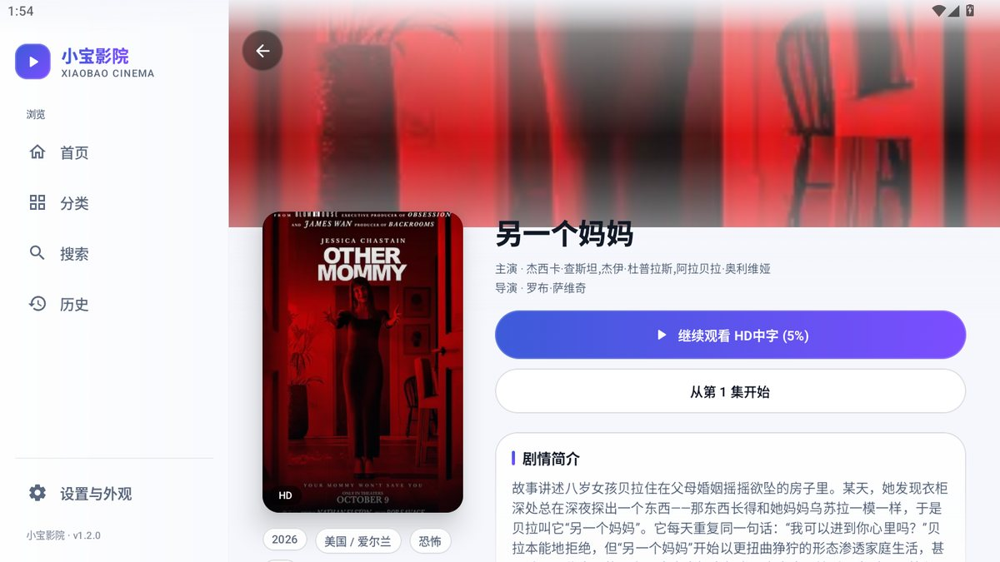<br/><sub>Two-pane detail</sub></td>
  </tr>
  <tr>
    <td align="center">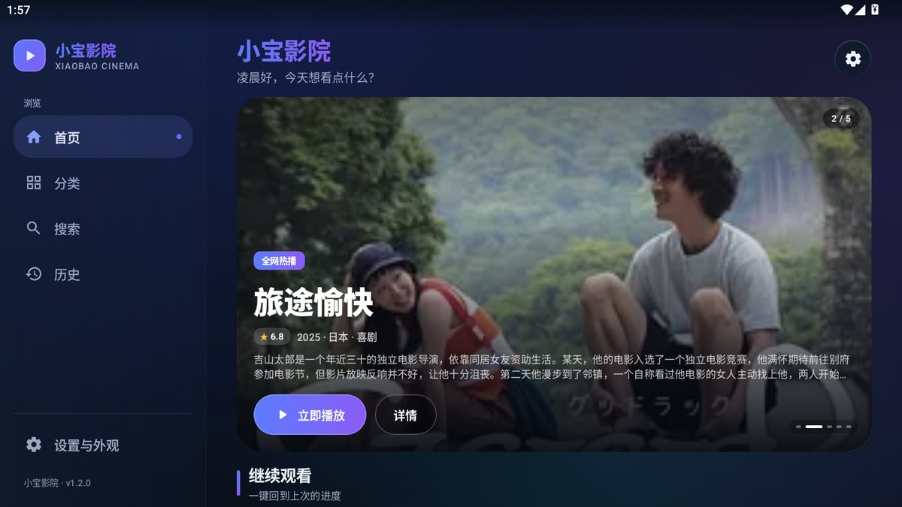<br/><sub>Midnight theme</sub></td>
    <td align="center">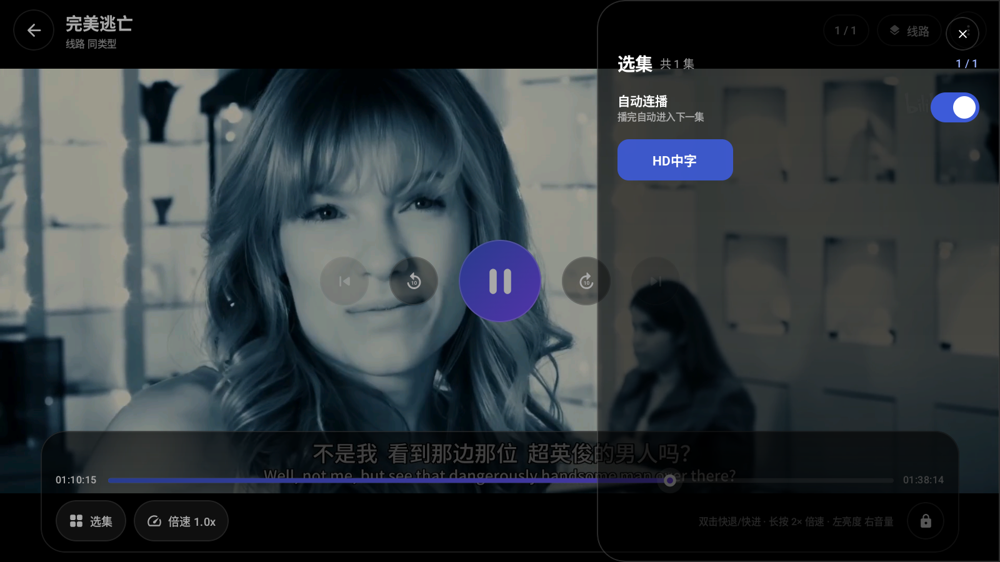<br/><sub>Player episode panel</sub></td>
  </tr>
</table>

</div>

More screenshots: [`docs/screenshots/`](docs/screenshots) · [`docs/player-screenshots/`](docs/player-screenshots)

---

## 🆕 What's new in v1.3 — Aurora Player

<table>
  <tr>
    <td width="50%">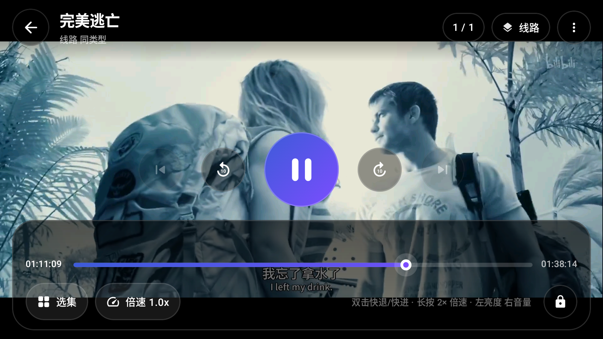</td>
    <td width="50%">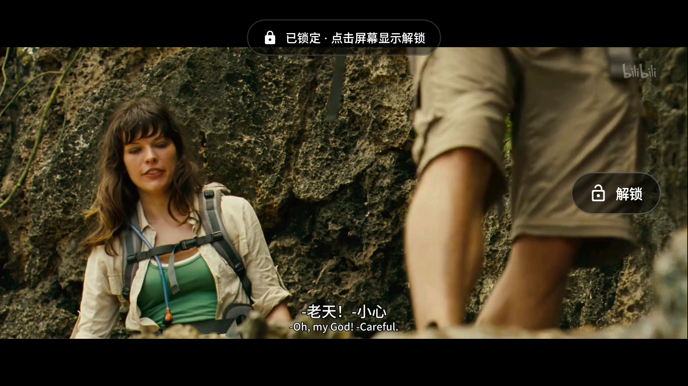</td>
  </tr>
  <tr>
    <td align="center"><sub><b>Five-button transport</b>: previous · −10 s · play · +10 s · next</sub></td>
    <td align="center"><sub><b>Screen lock</b>: hides the controls and blocks accidental touches</sub></td>
  </tr>
  <tr>
    <td>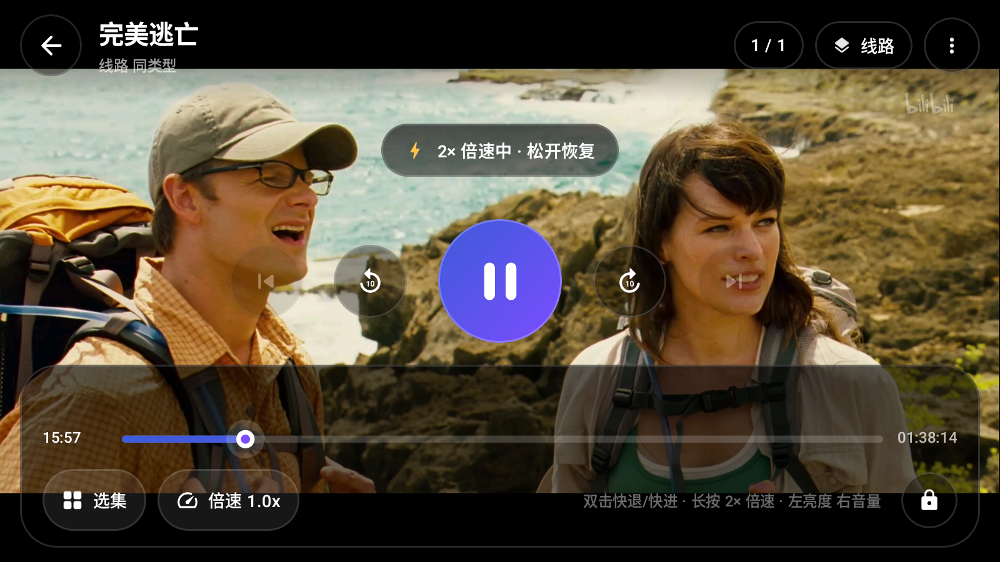</td>
    <td>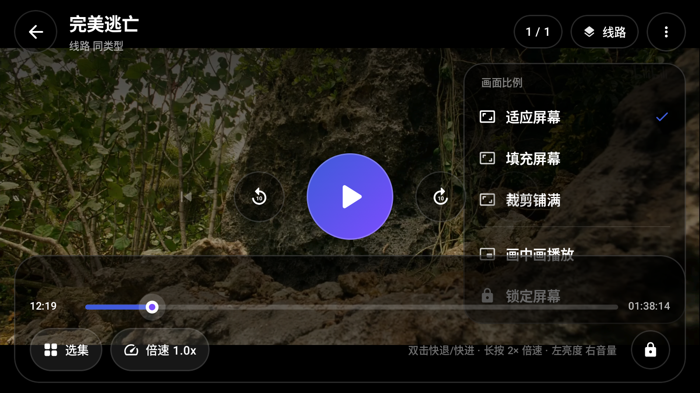</td>
  </tr>
  <tr>
    <td align="center"><sub><b>Long-press 2×</b>: release to return to normal speed</sub></td>
    <td align="center"><sub><b>Aspect ratio + picture-in-picture</b>: PiP starts automatically when you press Home</sub></td>
  </tr>
</table>

Also new: a scrubbing time bubble, tap-to-toggle remaining time, a "switch source" action on playback errors, a "play now" button on the auto-next card, and a slide-in episode panel on tablets. Full write-up: [docs/PLAYER_UPGRADE.md](docs/PLAYER_UPGRADE.md).

### Gesture cheat sheet

| Gesture | Action |
|---|---|
| Double-tap left / right | Rewind / forward 10 s |
| Long-press | 2× speed while held |
| Horizontal swipe | Seek with preview (up to 3 min across the screen) |
| Vertical swipe, left half | Brightness |
| Vertical swipe, right half | Volume |

---

## 📦 Install

1. Download the latest APK from [**Releases**](https://github.com/nestchao/XiaobaoYingYuan_APK/releases/latest), or from the [website](https://nestchao.github.io/XiaobaoYingYuan_APK/#download).
2. Allow your browser or file manager to **install unknown apps**.
3. Open the APK and install. Requires **Android 8.0 (API 26)** or newer.

> [!TIP]
> Each release lists the APK's SHA-256 so you can check the file before installing.
> To upgrade, install the new APK over the old one. If Android reports a signature conflict, uninstall the old version first.

---

## 🧩 Features

- **Home**: endless auto-advancing hero carousel with parallax artwork, a continue-watching row, content rows, skeleton loading and pull-to-refresh.
- **Detail**: full-bleed parallax backdrop, expandable synopsis, tag row, real source (线路) switching and an adaptive episode grid. Two panes on tablets.
- **Player** (Media3 ExoPlayer, HLS):
  - smoked-glass controls with a custom-drawn buffered seek bar
  - speed menu, long-press 2×, double-tap ±10 s, plus brightness, volume and seek gestures
  - screen lock, picture-in-picture and aspect ratio (fit / fill / crop)
  - episode drawer, or a side panel on tablets
  - auto-next with a countdown ring
- **Category**: Paging 3 infinite grid with animated filter pills, falling back to the HTML show page when the API returns nothing.
- **Search**: scraped results with infinite scroll, plus a local search history that prunes itself.
- **History**: watch history grouped by date, with swipe-to-delete and undo.
- **Settings**: theme studio (system / light / dark) with live preview cards, and an auto-next toggle.

---

## 🛠 Tech stack

| Area | Libraries |
|---|---|
| Language | Kotlin 2.1, Coroutines, Flow |
| UI | Jetpack Compose (Material 3), Navigation Compose, Core SplashScreen |
| DI | Hilt (KSP) |
| Networking | OkHttp 4 (HTML), Retrofit 2 + Moshi (vod list API) |
| Parsing | Jsoup |
| Persistence | Room, DataStore Preferences |
| Paging | Paging 3 |
| Media | Media3 ExoPlayer (HLS) with a 200 MB disk cache |
| Images | Coil (20% memory cache + 128 MB disk cache) |
| Performance | Baseline Profile (ProfileInstaller), R8 shrinking |
| Logging | Timber |

---

## 🏗 Architecture

The app uses **Clean Architecture + MVVM**, organised by feature, with one-way data flow through `StateFlow`.

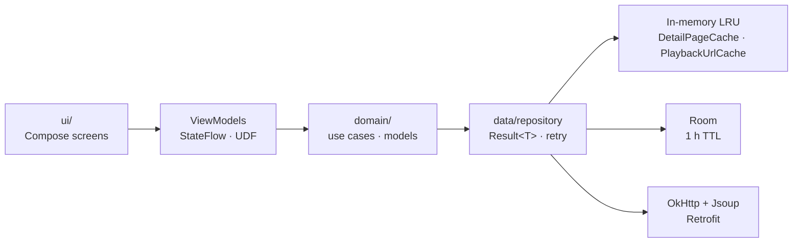

**How a title gets played**

1. **Detail**: `/movie/detail/{id}.html` → `VodDetailParser` → `VodContent`, cached in memory → Room → network.
2. **Sources and episodes**: `PlayPageParser` reads the source tabs and episode lists.
3. **Stream URL**: the play page is fetched and the `.m3u8` URL is pulled from its JavaScript variables. `DetailViewModel` does this ahead of time and stores the result in `PlaybackUrlCache`.
4. **Playback**: ExoPlayer streams the HLS playlist through its disk cache.

**Caching layers**

| Layer | What | Policy |
|---|---|---|
| `DetailPageCache` | Raw detail HTML | In-memory; removes duplicate fetches between repositories |
| Vod detail | Parsed `VodContent` | LRU → Room (1 h TTL) → network |
| `PlaybackUrlCache` | Resolved `.m3u8` URLs | In-memory LRU, filled ahead of time |
| OkHttp | HTTP responses | 10 MB; HTML forced to a 5-minute cache |
| ExoPlayer | Media segments | 200 MB disk cache |

Network calls retry with exponential backoff (2 attempts, 1 s initial delay).

---

## 🚀 Build from source

**Requirements:** JDK 17 · Android Studio Ladybug or newer · Android SDK 35 (min SDK 26)

```bash
git clone https://github.com/nestchao/XiaobaoYingYuan_APK.git
```

```bash
cd XiaobaoYingYuan_APK
```

```bash
./gradlew assembleDebug
```

| Command | Result |
|---|---|
| `./gradlew assembleDebug` | `app/build/outputs/apk/debug/app-debug.apk` |
| `./gradlew assembleRelease` | `app/build/outputs/apk/release/app-release-unsigned.apk` (R8 + resource shrinking) |
| `./gradlew installDebug` | Builds and installs on a connected device or emulator |
| `./gradlew testDebugUnitTest` | Runs the JVM unit tests (parsers, ViewModels) |

---

## 🗂 Project structure

```
app/src/main/java/com/xiaobaotv/app/
├── data/
│   ├── cache/        # DetailPageCache, PlaybackUrlCache (in-memory LRU)
│   ├── local/        # Room DB, DAOs, entities, UserPreferences (DataStore)
│   ├── model/        # Network DTOs (Moshi)
│   ├── parser/       # Jsoup parsers: VodDetail, PlayPage, SearchPage, ShowPage
│   ├── remote/       # Retrofit API (XiaobaoApi)
│   └── repository/   # Repository implementations
├── domain/
│   ├── model/        # VodContent, VideoSource, Episode, …
│   ├── repository/   # Repository interfaces
│   └── usecase/      # Thin use cases
├── di/               # Hilt modules
└── ui/
    ├── components/   # Glass, chips, shimmer, poster cards, progress ring, …
    ├── navigation/   # Adaptive scaffold (bottom bar / rail / sidebar), NavHost
    ├── theme/        # Aurora colours, type, shapes
    └── home · detail · player · category · search · history · profile
website/              # Static landing page (GitHub Pages)
docs/                 # Design docs and screenshots
```

Further reading: [docs/UI_REDESIGN.md](docs/UI_REDESIGN.md) (design system, motion spec, tablet layouts) · [docs/PLAYER_UPGRADE.md](docs/PLAYER_UPGRADE.md) · [website/README.md](website/README.md)

---

## 📝 Changelog

| Version | Date | Highlights |
|---|---|---|
| [**v1.3.0**](https://github.com/nestchao/XiaobaoYingYuan_APK/releases/tag/v1.3.0) · Aurora Player | 2026-11-15 | Five-button transport, screen lock, PiP, long-press 2×, scrub time bubble, tablet episode panel |
| [v1.2.0](https://github.com/nestchao/XiaobaoYingYuan_APK/releases/tag/v1.2.0) · Aurora UI | 2026-11-14 | Full redesign: glass design system, dual themes, phone and tablet navigation, all eight screens redrawn |
| [v1.1.0](https://github.com/nestchao/XiaobaoYingYuan_APK/releases/tag/v1.1.0) | 2026-09-14 | Infinite search paging, swipe seek preview, brightness and volume gestures, light theme |
| [v1.0.0](https://github.com/nestchao/XiaobaoYingYuan_APK/releases/tag/v1.0.0) | 2026-06-27 | First release: home carousel, categories, search, multi-source player, auto-next, caching |

---

## 🇨🇳 简体中文

**小宝影院**是一款免费、无广告、无需登录的 Android 观影应用，采用 Jetpack Compose 打造的「极光」设计语言：

- 午夜 / 瓷白双主题、玻璃质感与弹簧动效
- 手机悬浮导航、平板图标栏、大屏侧边栏三端自适应
- v1.3 全新播放器：五键中控、锁屏、画中画、长按 2× 倍速、拖动时间气泡
- 观看历史与偏好仅保存在本地

👉 [下载最新版本](https://github.com/nestchao/XiaobaoYingYuan_APK/releases/latest) · [访问官网](https://nestchao.github.io/XiaobaoYingYuan_APK/)，需要 Android 8.0 及以上。

---

## ⚠️ Disclaimer

This project is a client for publicly available web pages and is meant for learning and research only. It does **not** host, upload or distribute any video content. All media belongs to its respective owners.

<div align="center">
<sub>Made with Jetpack Compose · <a href="https://nestchao.github.io/XiaobaoYingYuan_APK/">nestchao.github.io/XiaobaoYingYuan_APK</a></sub>
</div>
