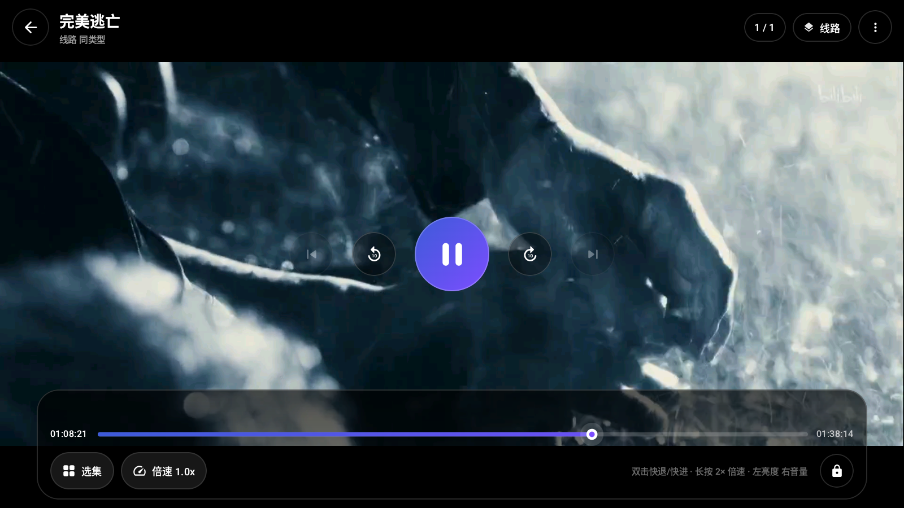
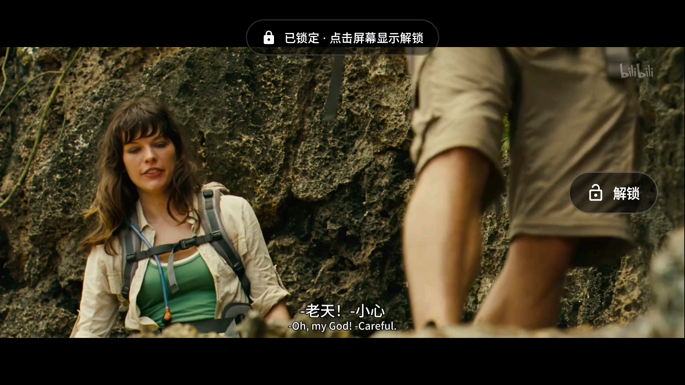
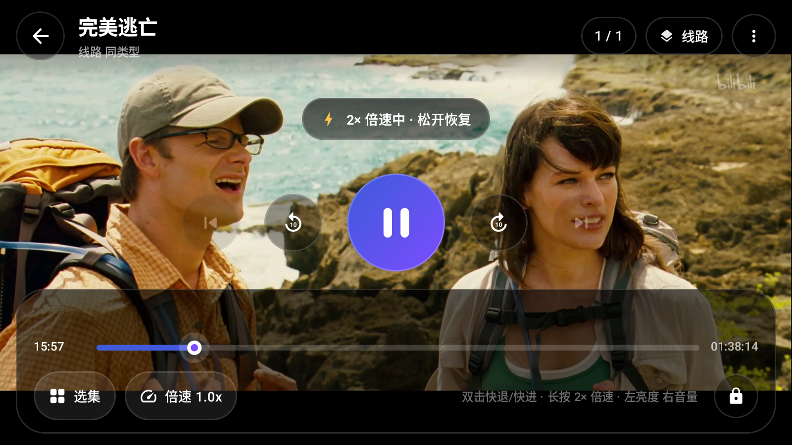
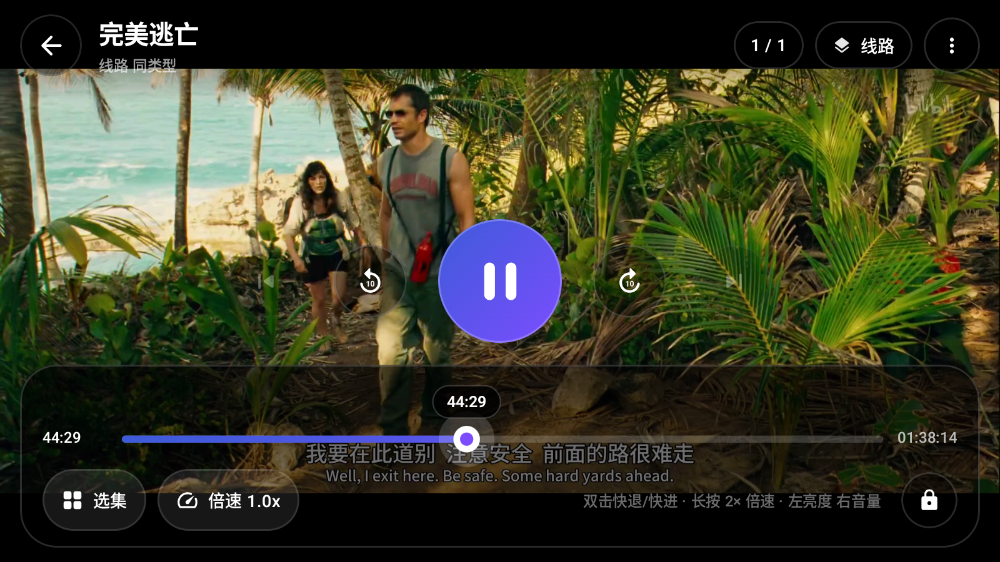
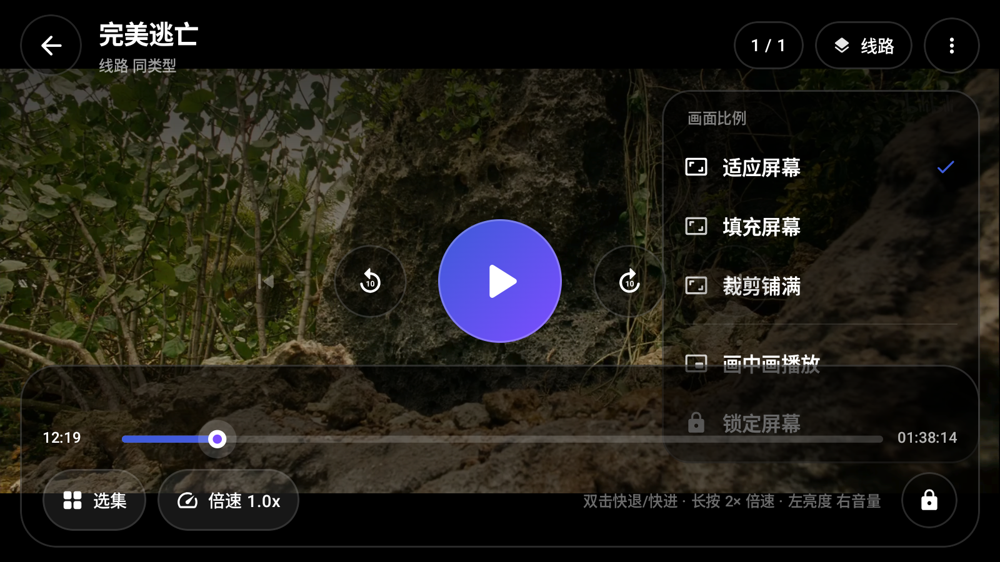
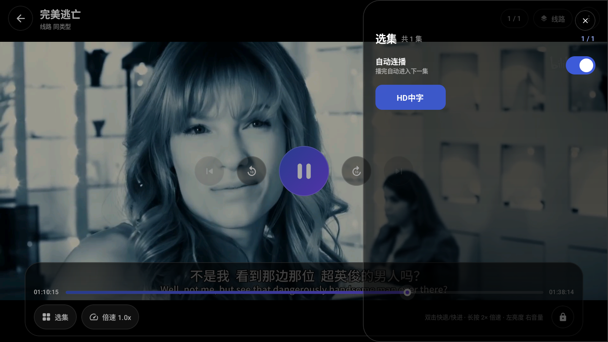

# Player v1.3 — Aurora Player Upgrade

The full-screen player (`ui/player/PlayerScreen.kt`) received a second design pass
focused on control ergonomics, safety and large-screen use. Playback, gesture and
lifecycle behaviour from v1.2 remains intact.

## What's new

### Chrome
- **Top bar** now shows the title of the title being watched (VOD name) with an
  episode / line subtitle, an episode counter, a quick **线路 (source)** chip and
  an overflow menu.
- **Overflow menu** (⋮): aspect ratio — 适应屏幕 / 填充屏幕 / 裁剪铺满, picture-in-
  picture, and screen lock. Rendered as a smoked-glass popup.
- **Center transport** is now a five-button cluster: previous episode, rewind 10 s,
  play/pause, forward 10 s, next episode. Side buttons shrink on compact widths.
- **Bottom panel** has aligned time labels (tap the total to switch to remaining
  time), a taller seek bar with a larger thumb, a floating **time bubble** while
  scrubbing, episode and speed chips, a gesture hint and a lock shortcut.
- **Buffering** is a compact glass pill with a spinner and "缓冲中…" label.
- **Error card** now offers "切换线路" in addition to retry when more than one
  source exists.
- **Auto-next** card gained an immediate "立即播放" action alongside cancel.

### New interactions
- **Screen lock** — hides all chrome and swallows every touch; a floating unlock
  pill appears when the screen is tapped. Haptic feedback on lock/unlock.
- **Picture-in-picture** — available from the overflow menu, and the player
  automatically floats when the user presses Home (via `onUserLeaveHint` +
  `PlayerPipBridge`). Chrome is hidden while floating.
- **Long-press 2× speed** — press and hold the video to play at 2× with a
  "2× 倍速中 · 松开恢复" badge; releasing restores the selected speed.
- **Double-tap seek** — unchanged ±10 s with ripple, now also haptic.
- **Lock-aware gestures** — brightness, volume, seek and tap handlers are all
  disabled while locked.

### Tablet
- On expanded widths the episode sheet becomes a **right-side glass panel** that
  slides in with a scrim, showing the auto-next switch, source chips and a
  three-column episode grid.

## Screenshots

| Tablet controls | Locked |
|---|---|
|  |  |

| Long-press 2× | Seek tooltip |
|---|---|
|  |  |

| Overflow menu | Tablet episode panel |
|---|---|
|  |  |

## Implementation notes

- `PlayerPipBridge` (new) connects the player composable with `MainActivity` for
  Home-press PiP and mirrors the system PiP state back into Compose.
- `PlayerViewModel` exposes `vodTitle`, `setAutoNextEnabled(...)` and
  `playNextEpisodeNow()`; the auto-next preference is persisted through DataStore.
- `AndroidManifest.xml` declares `android:supportsPictureInPicture="true"` and adds
  `smallestScreenSize` to `configChanges`.
- Aspect ratio is applied through `PlayerView.resizeMode`
  (`AspectRatioFrameLayout.RESIZE_MODE_*`).
- The seek bubble is drawn in the same `Canvas` as the track using `TextMeasurer`,
  so it needs no extra layout or popup window.
- Version bumped to **1.3.0** (`versionCode 4`).
