# 小宝影院 · "Aurora" UI Redesign (v1.2.0)

A ground-up visual and interaction redesign of the XiaobaoTV Android client:
a sleek, modern, minimalist design language built on Jetpack Compose, with
spring-physics motion and genuine phone / tablet adaptivity.

> Design intent: a premium streaming product — cinematic artwork floating on a
> deep midnight canvas, frosted-glass chrome, one confident brand gradient, and
> motion that feels physical rather than decorative. Every screen works in both
> light and dark themes, on 400dp phones, 600–840dp tablets and 1000dp+ large
> tablets/desktop-class windows.

---

## 1. Design system

| Token file | What it defines |
|---|---|
| `ui/theme/Color.kt` | Brand palette, dark/light Material 3 schemes and `XiaobaoExtraColors` (glass fill, hairline borders, scrims, aurora glows, shimmer, progress tracks, rating gold). |
| `ui/theme/Type.kt` | Media-tuned type scale: Black/ExtraBold display weights, comfortable 14–16sp CJK body copy, generous line heights, tightened display tracking. |
| `ui/theme/Shape.kt` | "Pebble" geometry — radii grow with surface size; shared `Radii` (chip, badge, poster, hero, card, sheet, nav bar). |
| `ui/theme/Motion.kt` | Motion vocabulary: durations (90/160/260/380/520ms), Material-expressive cubic-bezier easings, spring presets and press/scale constants. |
| `ui/theme/Theme.kt` | `XiaobaoTheme` — brand-locked color schemes (no dynamic color so posters stay the hero), status/navigation icon appearance, provides extra color tokens. |

**Palette**

- Dark ("midnight aurora"): canvas `#0A101C`, surfaces `#0E1626 → #1D2C47`,
  primary periwinkle `#8CA5FF`, amber `#FFBE73`, mint `#63E6CE`, violet/blue/cyan
  radial glows behind content.
- Light ("porcelain"): canvas `#F5F7FC`, white surfaces, primary `#3D5BD9`,
  airy lavender aurora washes.
- Brand gradient: `#5B7CFA → #8B5CF6` (dark) / `#3D5BD9 → #7C4DFF` (light),
  used for the wordmark, primary CTAs, progress fills and selected states.

**Motion principles**

1. *Press is physical*: every tappable surface springs to ~0.955 scale with a
   fast, low-bounce spring (`Modifier.pressScale`).
2. *Entrances are confident*: route transitions slide + scale with
   emphasized-decelerate easing; tab switches crossfade with a 0.985 scale.
3. *Draw-phase animation by default*: parallax, shimmer, seekbar and glows read
   scroll/pager state inside `graphicsLayer`/`drawBehind`/`Canvas` so they never
   recompose per frame.
4. *Choreographed reveals*: skeleton shimmer while loading, staggered chip
   reveals on first open, animated content size for expanding text.

**Component kit** (`ui/components/`)

`GlassSurface` · `GlassIconButton` · `TintedIconButton` · `ScrimPill` ·
`GradientPillButton` · `GlassPillButton` · `LinkPillButton` · `SelectChip` ·
`EpisodeChip` · `MetaChip` · `RatingBadge` · `BadgePill` · `GradientBadge` ·
`VodPosterCard` · `LandscapeVodCard` · `PosterCardSkeleton` · `ShimmerBox` ·
`AuroraBackground` · `XiaobaoSpinner` · `ProgressRing` · `EmptyState` /
`ErrorState` · `ExpandableSynopsis` · `XiaobaoTopBar` / `ScreenHeader` ·
`SectionHeader` · adaptive helpers (`WindowSize`, `LayoutMetrics`,
`ContentContainer`, `posterGridColumns`, `screenGutter`, …).

---

## 2. Adaptive navigation

Three layouts selected from window width, all in `ui/navigation/MainScreen.kt`:

| Window | Navigation | Notes |
|---|---|---|
| Compact (<600dp) | Floating frosted-glass pill at the bottom, animated selection capsule that glides between tabs, spring icon scaling, light haptic tick. Hidden on Detail / Settings / Player for immersion. | Content scrolls beneath the glass; screens reserve 124dp bottom clearance. |
| Medium (600–840dp) | 92dp icon rail with wordmark, labels and a settings entry at the bottom. | Keeps content wide for portrait tablets and foldables. |
| Expanded (≥840dp) | 244dp labelled sidebar: gradient brand mark + wordmark, "浏览" section, animated selected rows with gradient dot, settings + version footer. | Desktop-class large-tablet layout. |

A soft top scrim keeps status-bar icons legible while edge-to-edge content
scrolls underneath; content never fights the system bars.

Route transitions (`XiaobaoNavHost.kt`):

- **Detail**: fade + slide-up-from-1/6 + scale from 0.94 (cinematic container feel).
- **Player**: slides up from the bottom like a modal.
- **Settings**: slides in from the right with a fast fade.
- **Tabs**: short crossfade + micro-scale; pop transitions are mirrored
  (detail slides away downward while the previous screen scales back in).

---

## 3. Screens

### Home — cinematic hero + content rails
- Full-bleed gradient wordmark header, time-aware greeting, glass settings button.
- **Hero carousel**: infinite pager, 5.6s auto-advance that pauses while the
  user drags, artwork parallax (draw-phase), cinematic multi-stop scrims,
  "全网热播" gradient badge, rating + year/region/genre meta, 2-line synopsis,
  "立即播放" gradient CTA and dark-glass "详情" secondary, animated page-indicator
  capsule and slide counter.
- **继续观看** rail: 16:9 cards with episode chip, brand-gradient progress and
  percentage; tapping resumes the exact episode in the player.
- **热门电影 / 热门剧集 / 热门动漫** rails: poster cards with score pill, remarks
  badge and quiet metadata; press-scale spring.
- Skeleton shimmer on first load, pull-to-refresh, graceful error state with
  retry, and hero fallback (TV/anime) when the movie endpoint is slow.
- The hero is the first thing users see; long titles are tuned to stay on two
  lines on 400dp phones.

### Detail — poster-first editorial page
- 384dp (phone) / 344dp (tablet) full-bleed backdrop behind the status bar with
  draw-phase parallax and a late, theme-aware fade into the canvas.
- Floating glass back button; poster card (shadow + hairline) overlapping the
  artwork; title, rating/meta glass chips (remarks date suffix trimmed),
  cast/director lines.
- Primary CTA becomes "继续观看 第X集 (xx%)" from watch history; secondary
  "从第 1 集开始". Gradient + glass pill pair.
- Expandable synopsis card, real source switching (线路 chips), 100-episode
  group paging, adaptive episode grid (3/4/5/6/8 columns from measured width),
  skeleton → content crossfade, source-error retry card.
- **Tablet**: two-pane layout (poster/meta left, title/credits/CTA/synopsis/
  episodes right) inside a 1400dp max-width container; CTA sits next to the
  title so it stays above the fold on short landscape tablets.

### Player — dark smoked-glass cinema chrome
- Theme-independent dark controls (white glyphs always readable over video):
  glass back + episode title + source line + episode counter, morphing
  gradient play/pause, prev/next glass circles.
- Hand-drawn `AuroraSeekBar`: buffered track, gradient played track, thumb that
  swells while dragging, drag preview and tap-to-seek.
- Glass control panel with 选集 / 倍速; inline animated speed picker.
- `ModalBottomSheet` episode sheet: drag handle, source chips, adaptive
  4/6/8-column episode grid, current episode highlighted; wraps its content
  height (short lists no longer leave a tall empty sheet).
- Animated volume/brightness medallion, top-center seek preview, double-tap
  side ripple, auto-next countdown card with progress ring, buffering spinner,
  glass error card with retry.
- All original gestures preserved: left/right vertical drag for
  brightness/volume, horizontal drag to scrub (preview → seek on release),
  double-tap ±10s, tap to toggle controls. Controls auto-hide after 4.5s and
  stay visible while scrubbing / in sheets / adjusting.
- Modern immersive mode via `WindowInsetsControllerCompat` (transient bars by
  swipe), keep-screen-on, `fullScreenState` hides app chrome, safe-area
  padding for notches; black `PlayerView` background avoids white flashes.

### Category — pinned animated filters + adaptive grid
- Editorial header with refresh glass button, horizontally scrollable icon
  filter pills with staggered first-open reveal and a gradient-accent selection
  caption ("电影 · 院线新片与高分佳作", loaded count).
- Adaptive poster grid (3/4/6 columns), page-append footer with spinner /
  retry / "已经到底啦", skeleton grid on first load, empty/error states,
  pull-to-refresh.

### Search — aurora search field + ranked discovery
- Custom glass search field (not an OutlinedTextField look): focus-animated
  border/fill/icon tint, animated clear, gradient circular submit, IME search.
- Idle: recent searches (tap to search, per-chip delete with animated removal,
  clear-all), ranked hot searches with gradient number badges and staggered
  reveal; Expanded adds a two-column discovery panel.
- Results: adaptive grid, query caption + count + clear, infinite scroll,
  loading/empty/error states, tablet max-width container, `imePadding` so the
  keyboard never hides results.

### History — date-grouped cards with swipe-to-delete
- Today / Yesterday / This week / Earlier groups from `lastWatchedAt`, custom
  gradient section labels.
- Frosted cards: 16:9 thumbnail with play affordance, 2-line title, episode
  chip, relative time, gradient progress + percent, subtle delete button.
- Swipe-to-dismiss with red glass reveal (correctly hidden at rest), Snackbar
  "已删除 · 撤销" restoring the full record, themed clear-all dialog, staggered
  entrance, skeleton and empty state.
- Tablet: 2-column grid of cards that switch to a vertical layout when narrow.

### Settings — live theme studio
- Glass section cards with gradient accent labels: 外观 / 播放 / 关于.
- Three theme preview cards (跟随系统 split light/dark mock, 浅色, 深色) with
  fixed palettes so previews stay true in every theme, animated selection
  border + spring check badge, live description crossfade; tapping applies the
  theme instantly.
- Auto-next switch row (whole row toggleable), about card with brand mark,
  gradient wordmark, DEBUG/RELEASE chip, version from `BuildConfig`.
- Tablet: centered 720dp column; animated section entrance.

### Chrome & identity
- New adaptive launcher icon: midnight aurora background with a gradient play
  tile + monochrome themed variant for Android 13+.
- Splash background matches the Compose canvas (values/values-night) so there
  is no white/black flash on launch.
- App version bumped to **1.2.0** (versionCode 3).

---

## 4. Tablet & window compatibility

- Three navigation modes (floating bar / icon rail / labelled sidebar).
- Adaptive grids: 3 columns phone, 4 portrait tablet, 6 expanded tablet.
- Two-pane Detail, two-column History/Search, centered max-width containers.
- Player chrome scales to landscape tablets and stays centered/legible.
- All screens handle edge-to-edge insets themselves: status bar, navigation
  bar, IME (search) and display cutouts (player).
- Verified on the MuMu emulator at:
  - 400 × 711dp phone portrait
  - 600 × 1066dp tablet portrait (icon rail)
  - 1066 × 600dp tablet landscape (sidebar)
  in both light and dark themes.

---

## 5. Verification snapshot

- `./gradlew assembleDebug` and `./gradlew assembleRelease` both succeed;
  R8/minified release APK is ~3.2 MB and was installed and smoke-tested.
- Screen-by-screen emulator QA with screenshots (see `docs/screenshots/`):
  Home loading skeleton → content, pull-to-refresh, hero auto-advance,
  Category filter switching + pagination, Search idle/results/load-more,
  History swipe delete + undo, Settings live theme switching, Detail scroll +
  source/episode interaction, Player playback + controls + episode sheet.
- Frame stats while scrolling Home: 0 janky frames, 0 missed vsync, 0 slow UI
  thread / draw commands reported by `dumpsys gfxinfo`.

### Screenshot gallery

| | |
|---|---|
| 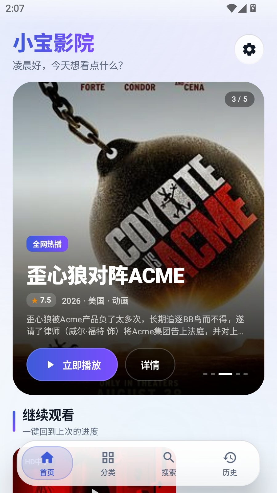 | 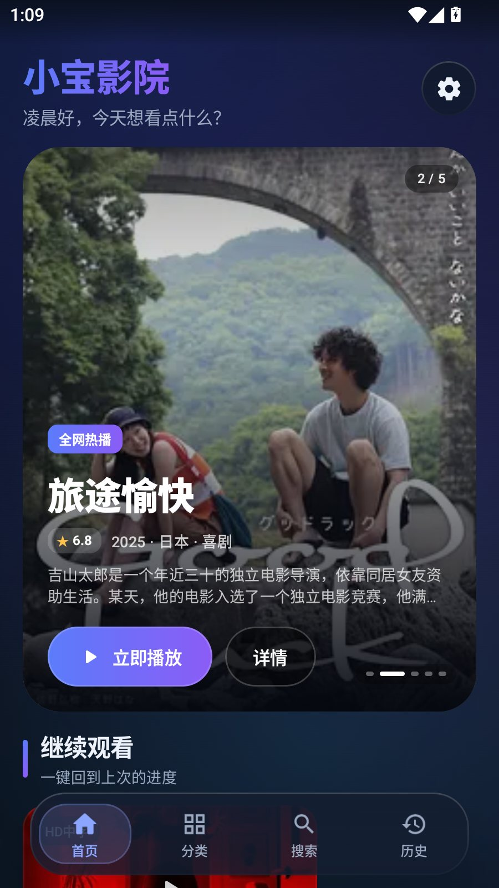 |
| 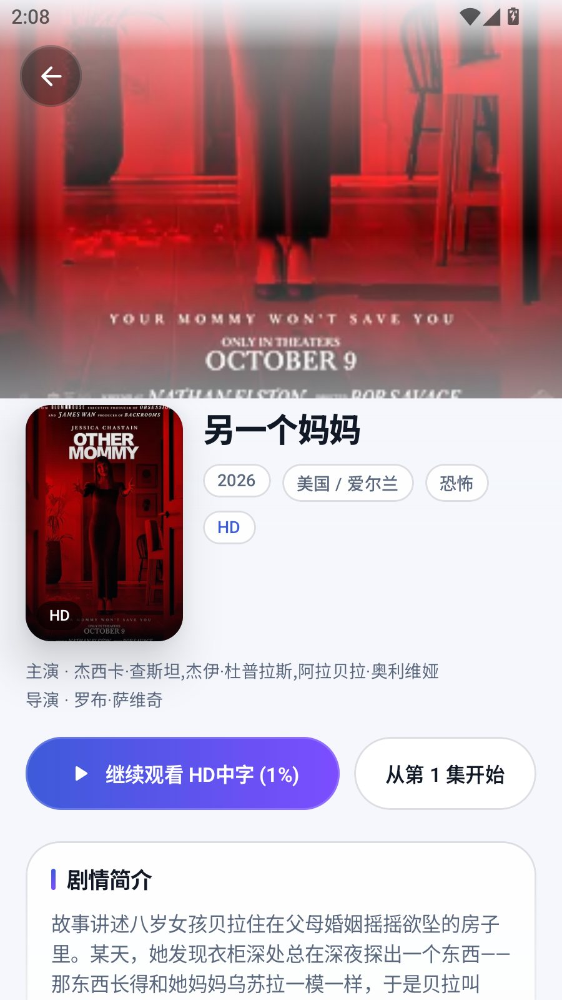 | 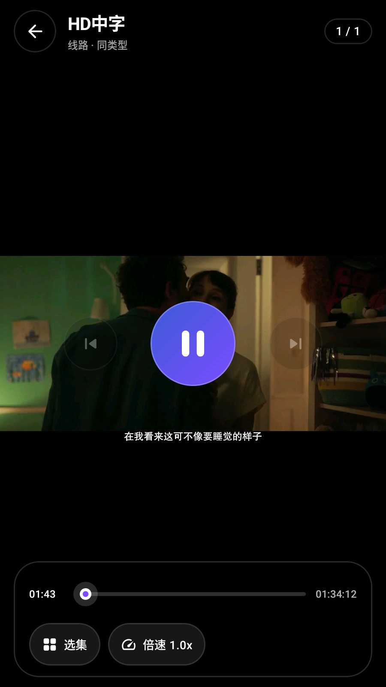 |
| 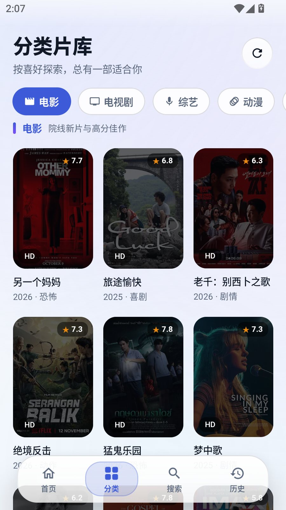 | 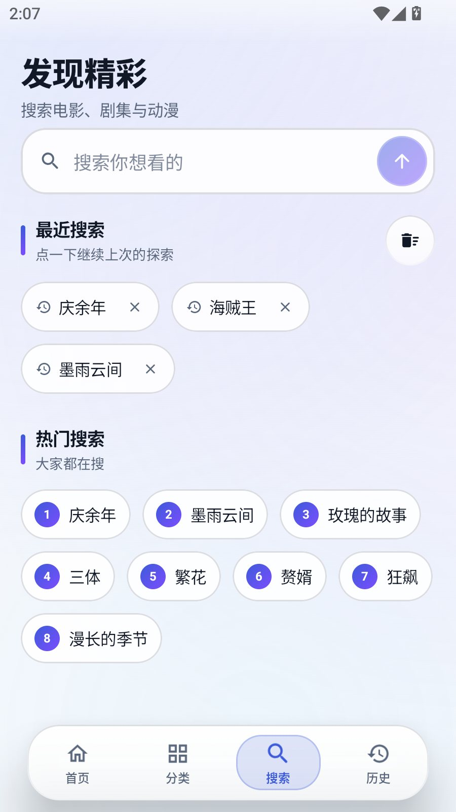 |
| 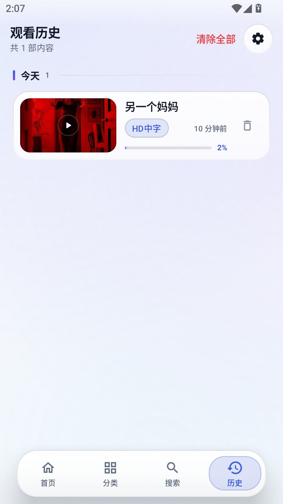 | 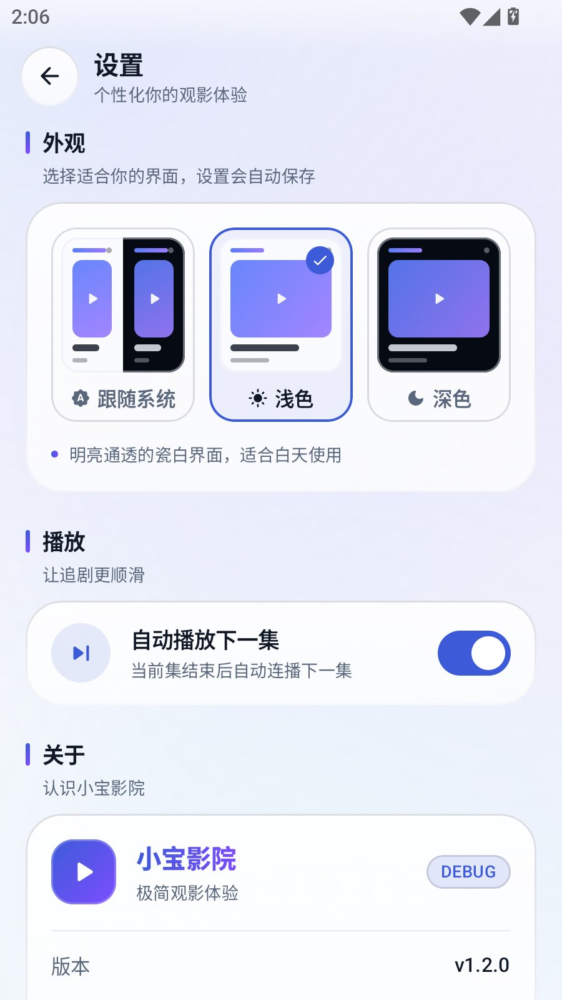 |
|  | 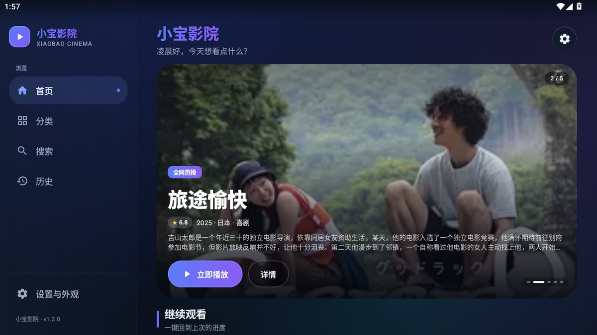 |
| 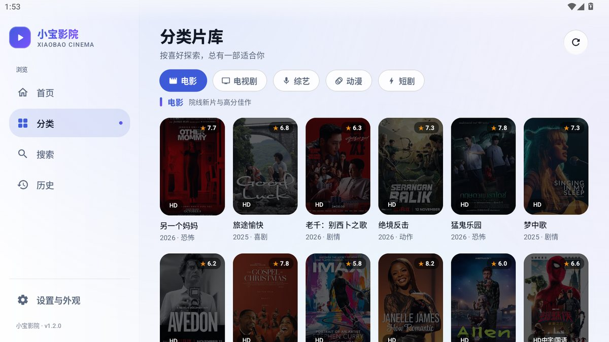 | 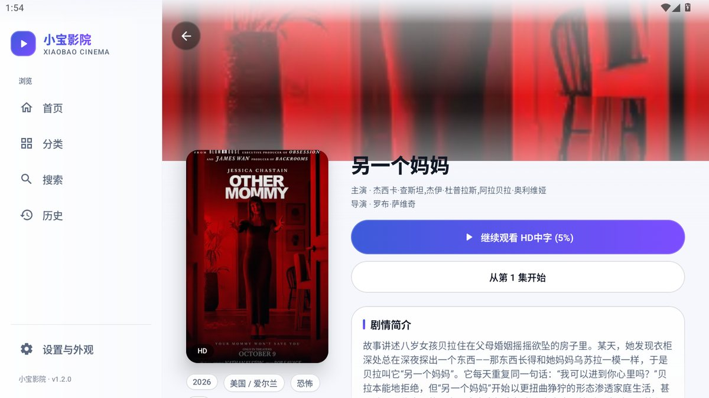 |
| 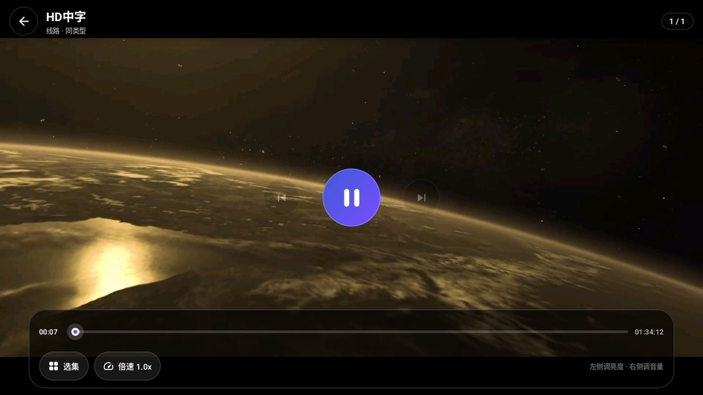 | 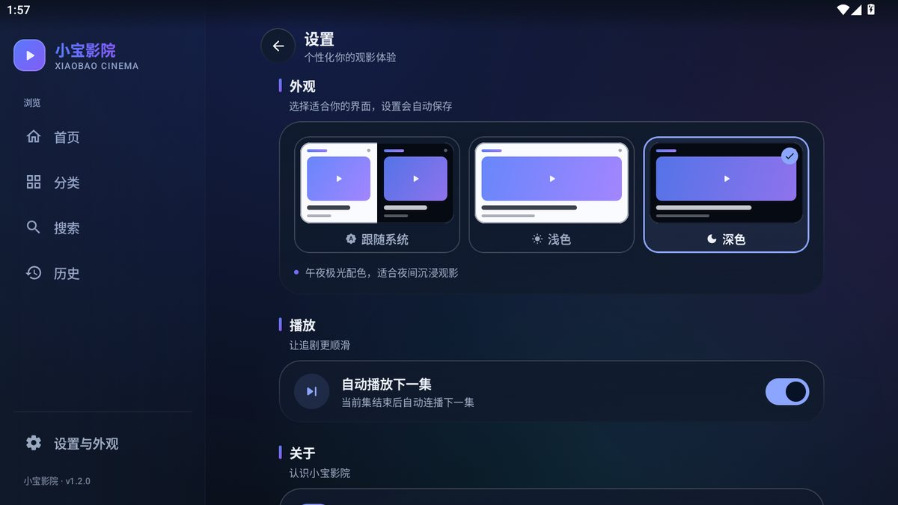 |
| 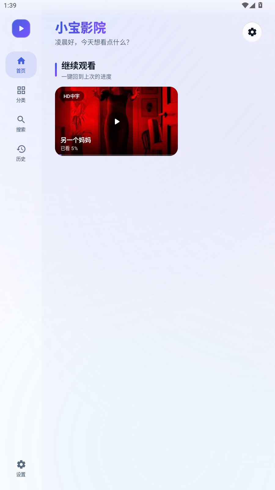 | 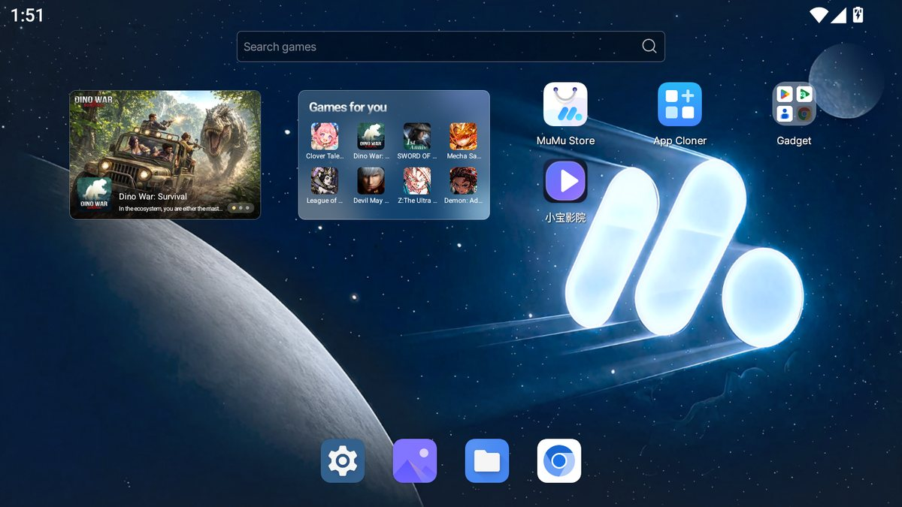 |

---

## 6. Where things live

```
app/src/main/java/com/xiaobaotv/app/
├── MainActivity.kt                 # edge-to-edge + theme mode
├── ui/
│   ├── theme/                      # Color, Type, Shape, Motion, Theme
│   ├── components/                 # Aurora design-system kit
│   ├── navigation/                 # MainScreen (bar/rail/sidebar), NavHost transitions
│   ├── home/                       # cinematic Home + hero carousel
│   ├── detail/                     # two-pane detail, parallax backdrop
│   ├── player/                     # dark glass player chrome + gestures
│   ├── category/                   # animated filters + adaptive grid
│   ├── search/                     # aurora search field + discovery
│   ├── history/                    # grouped history + swipe delete/undo
│   └── profile/                    # theme studio + settings
└── res/                            # adaptive launcher icon, splash colors
```
